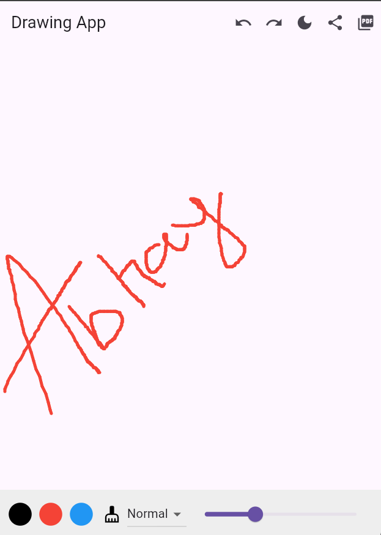

# Drawing App — Flutter Digital Drawing Application

<p align="center">
  
  
  
  
</p>

<p align="center">
  A simple and smooth digital drawing app built with Flutter and Dart by
  <a href="https://github.com/abhayguptadev">Abhay Gupta (@abhayguptadev)</a>.
</p>

<p align="center">
  Create sketches, experiment with colors, adjust brush sizes, and add glow effects to your drawings.
</p>

<p align="center">
  <a href="https://github.com/abhayguptadev/drawing-app">View Repository</a> •
  <a href="https://abhayguptadev.com/">Developer Portfolio</a> •
  <a href="https://www.linkedin.com/in/abhayguptadev/">LinkedIn</a>
</p>

---

## About the Project

**Drawing App** is a Flutter-based digital drawing application designed for creating simple sketches through an interactive canvas. Built with Dart and Flutter's `CustomPaint`, the app provides drawing controls for colors, brush sizes, and glow effects.

This project demonstrates Flutter UI development, custom canvas painting, and interactive mobile application design.

## Features

- **Smooth Drawing Canvas:** Draw sketches directly on the canvas.
- **Multiple Brush Colors:** Choose different colors for your artwork.
- **Adjustable Brush Sizes:** Customize the thickness of your strokes.
- **Glow Effect:** Add a glowing visual effect to your drawings.
- **Clear Canvas:** Clear the drawing area and start again.

## Screenshots

<p align="center">
  
</p>

<p align="center">
  <em>Drawing App — Flutter drawing interface</em>
</p>

## Technology Stack

<p>
  
  
</p>

- **Flutter:** Cross-platform mobile application framework.
- **Dart:** Programming language used to build the application.
- **CustomPaint:** Flutter API for custom canvas drawing and rendering.

## Getting Started

Follow the instructions below to run the Flutter drawing application locally.

### Prerequisites

Install the following tools:

- [Flutter SDK](https://docs.flutter.dev/get-started/install)
- [Android Studio](https://developer.android.com/studio) or [Visual Studio Code](https://code.visualstudio.com/)
- An Android emulator or a compatible physical device

Verify your Flutter installation:

```bash
flutter doctor
```

### Installation

**1. Clone the repository**

```bash
git clone https://github.com/abhayguptadev/drawing-app.git
```

**2. Navigate to the project directory**

```bash
cd drawing-app
```

**3. Install dependencies**

```bash
flutter pub get
```

**4. Run the application**

```bash
flutter run
```

Make sure your emulator or physical device is connected and detected by Flutter.

## How to Use

1. Launch the Drawing App.
2. Draw on the canvas using your finger or a compatible input device.
3. Select a brush color from the available color options.
4. Adjust the brush size to create thinner or thicker strokes.
5. Use the glow effect to change the appearance of your strokes.
6. Clear the canvas when you want to start a new drawing.

*The exact control layout may vary with the implementation.*

## Project Structure

```text
drawing-app/
├── assets/
│   └── img.png             # App screenshot
├── lib/                    # Flutter application source code
├── android/                # Android project configuration
├── ios/                    # iOS project configuration
├── pubspec.yaml            # Dependencies and app configuration
├── analysis_options.yaml   # Dart analysis settings
└── README.md
```

The listed folders are typical Flutter project components. Your repository may contain additional or differently named files.

## Future Improvements

Potential enhancements for future versions include:

- [ ] Undo and redo drawing actions.
- [ ] Save or export drawings as image files.
- [ ] Add an eraser tool.
- [ ] Add more brush styles.
- [ ] Improve canvas controls and accessibility.

These are suggestions for future development, not claims about existing features.

## Contributing

Suggestions, bug reports, and improvements are welcome. Feel free to open an issue or submit a pull request with a clear description of your changes.

## License

This project is licensed under the **MIT License**. See the [`LICENSE`](LICENSE) file for the full license terms.

## Author

**Abhay Gupta** — App Developer

- GitHub: [@abhayguptadev](https://github.com/abhayguptadev)
- Portfolio: [abhayguptadev.com](https://abhayguptadev.com/)
- LinkedIn: [Abhay Gupta](https://www.linkedin.com/in/abhayguptadev/)

---

<p align="center">
  Built with Flutter by <a href="https://github.com/abhayguptadev">Abhay Gupta (@abhayguptadev)</a>
</p>
